# Event-camera emulator + spiking neural network on an FPGA

**Turn ordinary video into DVS-style event streams in FPGA hardware, and classify what is happening with an integer-only spiking neural network running on the same chip.** Built on a Terasic DE10-Standard (Intel Cyclone V SoC). Video clips are streamed from a laptop over Ethernet, through the ARM (HPS) into DDR3, through a DMA into the FPGA, and the network's answer comes back in about 9 ms per frame.

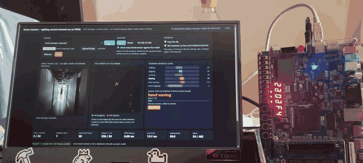

*Filmed with a phone: the browser live demo on the laptop sends a phone clip of a person waving (`hand_waving1_crop.mp4`) to the DE10-Standard on the right at 30 frames/s, and the FPGA classifies it frame by frame. On the page: the 128x128 frame the board receives, the DVS events of that frame, the six running class scores and the answer of every finished 32-frame window: **hand waving**, every window. The counters show the FPGA latency (8.89 ms), the round trip (14 ms) and **"board == model: 184 / 184 frames match"**: every answer of the board is checked live against the bit-accurate Python model. The board's own 7-segment display agrees with the page: `b8 18 F4` reads HEX5..4 = `b8` = frame 184, HEX3..2 = `18` = step 24 of the current window (hex), HEX1 = a fixed `F` separator, HEX0 = `4` = class 4, hand waving. At the end the clip answer is hand waving, with board == model on all 462 frames. Still image: [`docs/media/live_demo_board.jpg`](docs/media/live_demo_board.jpg).*

> **Honest status.** The whole chain runs on the real board: video clips go from the laptop over Ethernet through the ARM into DDR3, a DMA feeds the FPGA, and the FPGA's answers were compared with the bit-accurate Python models on **13,500+ frames (KTH clips, thermal and night-time footage, phone clips): 0 frames differ**; an 8,000-frame soak ran without a dropped frame or an error flag. The network is right on 79.9% of unseen KTH clips, but it knows only six actions, has no "none of these" answer, and gets worse on footage unlike KTH. The board's own ARM runs the same network faster than this FPGA engine. Power is a Quartus estimate, not a measurement. [Hardware status](#hardware-status) lists exactly what was measured where.

## Contents
1. [Results at a glance](#results-at-a-glance)
2. [Main findings](#main-findings)
3. [System architecture](#system-architecture)
4. [The event-camera emulator](#the-event-camera-emulator)
5. [The spiking neural network](#the-spiking-neural-network)
6. [Training data and results](#training-data-and-results)
7. [Comparisons and ablations](#comparisons-and-ablations)
8. [Hardware implementation](#hardware-implementation)
9. [Verification](#verification)
10. [Measured on the board](#measured-on-the-board)
11. [The main clips and what the board answered](#the-main-clips-and-what-the-board-answered)
12. [Hardware status](#hardware-status)
13. [Sending video clips from the laptop](#sending-video-clips-from-the-laptop)
14. [Live demo in the browser](#live-demo-in-the-browser)
15. [Recording your own training clips](#recording-your-own-training-clips)
16. [Reproduce everything](#reproduce-everything)
17. [Repository layout](#repository-layout)
18. [Limitations](#limitations)
19. [Adding board results](#adding-board-results)
20. [Datasets, licences, references](#datasets-licences-references)

---

## Results at a glance

| | |
|---|---|
| **Task** | classify 6 human actions (walking, jogging, running, boxing, hand waving, hand clapping) from video, via an emulated event camera |
| **Accuracy (KTH, unseen test people)** | **79.9% per clip, 72.7% per 1-second window** (validation people: 80.7% / 76.5%); best classes boxing 92%, walking 92%; weakest jogging/running (~66%) |
| **Same network on real DVS recordings** (DVS128 Gesture, 11 classes) | 82.7% per window / 89.8% per sample (32x32, 16/32 channels) |
| **Network** | 2 conv layers (2->16->32) + FC, spiking LIF neurons, **int8 weights, no multipliers, 17,184 weights**, 12-bit membranes |
| **Versus the ARM** | the board's own Cortex-A9 running the same pipeline in C (bit-exact): 1.43 ms per frame event-driven, 6.43 ms dense, against 8.89 ms for the FPGA engine: the CPU is faster for this network |
| **Speed** | 205,832 clocks per frame at 25 MHz = **8.2 ms** (27% of a 30 fps frame); DMA start to result **8.89 ms measured on the board** (222,236-222,245 clocks; simulation 222,233); sustained **29.4 frames/s** at real-time pace, 84.7 frames/s flat out |
| **Chip usage** (whole board design incl. HPS) | 5,243 ALMs (13%), 79 of 553 RAM blocks (11%), 0 DSP, timing met at all corners |
| **Event sparsity** | the emulator turns 16,384 pixels per frame into events on only 1.4-4.7% of the pixels on KTH clips (229-773 events per frame) |
| **Hardware vs model** | bit-exact in simulation (random, saturating and real networks, the whole chain) **and on the real board: 3,600 KTH frames + 6,280 thermal / night frames + 3,640 phone-clip frames, 0 frames differ** (spike counts, event counts, class currents, window scores) |
| **Versus real DVS data** | a network trained on real DVS events does **not** work on events emulated from video (hand clapping 80% -> 20%), so the demo network is trained on emulated events |
| **Live demo** | browser page: sample clips, your own video or the webcam, Board or Model backend, live board == model counter; a recorder saves labelled webcam clips for training |
| **Tests** | 60 Python tests, 7 emulator + 5 SNN + 2 VGA RTL benches, mutation self-test: all 12 harmful emulator-side variants and 14 of 15 SNN-side variants caught; browser test of the recorder (headless Edge, fake camera) |
| **Bugs found and documented** | 40 entries in [`docs/bug_log.md`](docs/bug_log.md), each with symptom, root cause, fix and lesson |

---

## Main findings

1. **Hardware equals the model, exactly, on everything tried.** The FPGA's answers (spike counts, event counts, six class currents, window scores and class) were compared frame by frame with the bit-accurate Python models on KTH clips, thermal pedestrian footage, a dark noisy room and handheld phone clips: 13,520 frames, 0 differ. Training is quantisation-aware with a forward pass that is bit-exact to the integer model, so there is no gap between the trained network and the chip either.
2. **The network works on the kind of video it was trained on**: 79.9% per clip and 72.7% per one-second window on KTH people it never saw. Per clip, boxing and walking reach 92%, hand waving 88%, hand clapping 76%; **jogging versus running is the weak pair** (65-67%), because 32x32 presence maps over one second carry little speed information.
3. **Real DVS training data does not transfer to emulated events.** A network trained on IBM's DVS128 Gesture recordings (82.7% / 89.8% there) collapses on events emulated from KTH video (hand clapping 80% -> 20-25%, waving 96% -> 52%), whatever the emulator threshold. The emulated input is 3 to 5 times sparser (3-6% of input cells active against 16.6%) and the motions differ. The demo network is therefore trained on emulated KTH events.
4. **The board's own ARM is faster than this FPGA engine.** The same pipeline in C on the Cortex-A9, bit-exact to the model: 1.43 ms per frame event-driven, 6.43 ms dense, against 8.89 ms for the FPGA (8 channels per pass at 25 MHz, 13% of the chip). The FPGA gives a fixed latency (9 clocks of jitter over 8,000 frames) and a free CPU, not speed. More parallel channels or an event-driven engine would change that; neither is built.
5. **There is no "none of these" answer.** An empty dark room where only sensor noise makes events is called running or walking in every window; a person sitting down is called walking. Noisy input (13-24% of pixels as events, against 1-5% on KTH) pushes everything towards "running".
6. **Footage unlike KTH degrades gracefully, then fails.** Thermal pedestrians: the clip answer is still walking every time, but only 33-76% of windows say so. Phone clips of a backlit person far down a corridor: hand waving is recognised (every window), **hand clapping never is** (every clapping clip is answered hand waving).
7. **Zooming in on a handheld clip made it worse.** Cropping tightly around a small person magnified the camera shake into events on every wall edge (events 1% -> 3-6% of pixels) and the answers became running and jogging. Shake removal plus a mild crop is the best preparation found; a tight crop is worse even with shake removal.
8. **One bug only the real board could show**: every reply of the ARM daemon left as two small TCP writes and paid a 40 ms delay, so the first board run managed 20 frames/s; one write per message brought the round trip from 48.7 ms to 11.7 ms and real-time 30 frames/s.
9. **Power was not measured.** Quartus estimates 531 mW for the FPGA fabric (78-87% of it device static power) with "low" confidence and without the ARM, so no energy claim against the ARM is made.

---

## System architecture

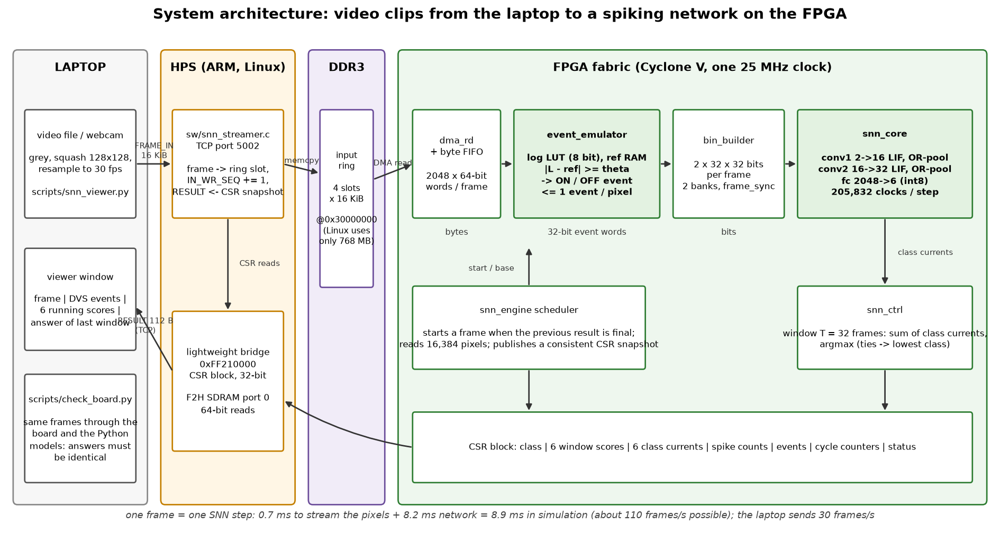

### The whole system, laptop side included

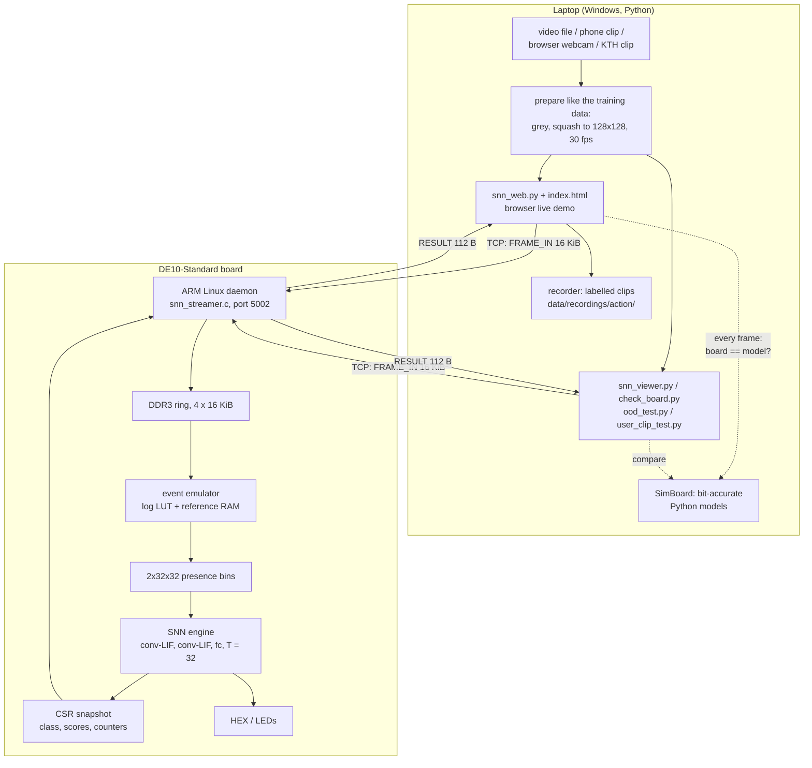

### How a network gets onto the chip, and how each step is checked

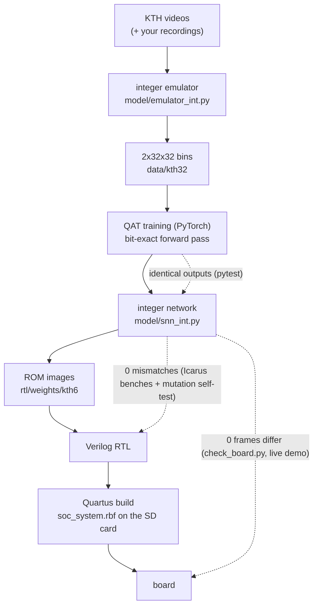

### One frame through the board

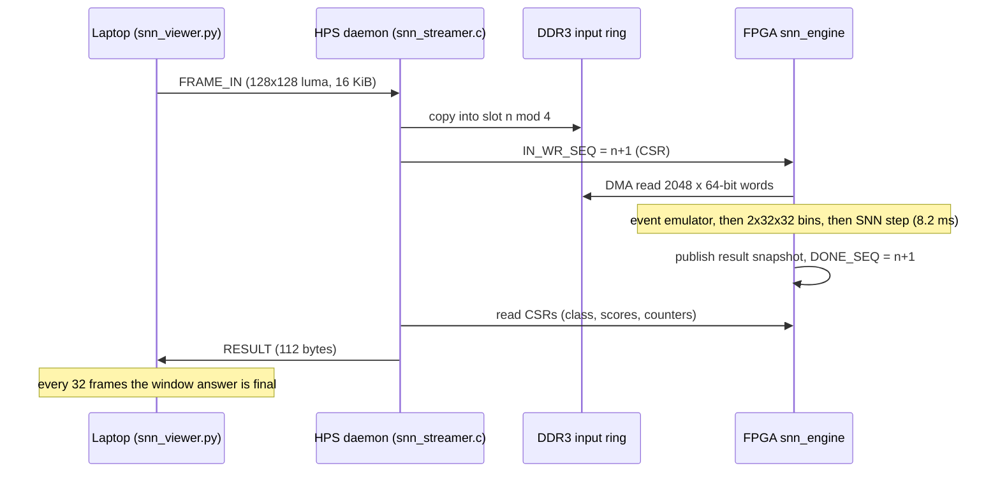

One frame is one network time step, whatever the wall-clock rate at which frames arrive: the emulator stamps frames by count, exactly as the training data was built. The engine starts a new frame only after the previous result is final, so the network can never overrun.

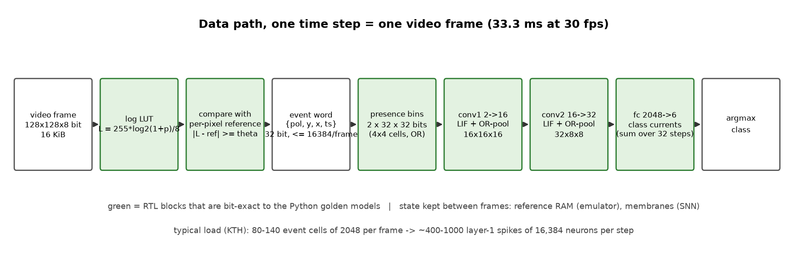

**Event word** (32 bit): `{polarity[31], y[30:24], x[23:17], timestamp[16:0]}`, timestamp tick 100 us, one timestamp per frame. **Network input** per frame: two binary 32x32 maps (OFF/ON), a bit is set when any event of that polarity falls into the 4x4-pixel cell during the frame.

### Why these design choices
Each choice is a numbered decision with its evidence in [`docs/architecture_decisions.md`](docs/architecture_decisions.md): frame-synchronous time bins (D1, D4), 32x32 input (D5), integer neuron without multipliers (D6), on-chip demo before DMA (D7), back-pressure instead of dropped events (D9), non-spiking sum readout (D10), network size from a measured study (D11), training on KTH instead of DVS128 (D12), output-stationary SNN engine (D13), replay + live demo (D14).

---

## The event-camera emulator

A real DVS pixel reports an event whenever its **log** brightness has changed by a threshold since its last event. The emulator does this per frame, in hardware (`rtl/event_emulator.v`):

1. each 8-bit pixel goes through a **log LUT** (`L[p] = round(255 * log2(1 + p) / 8)`, one LSB = 0.02175 ln units),
2. it is compared with a per-pixel **reference** stored in RAM,
3. if `L - ref >= theta` an **ON** event is emitted, if `<= -theta` an **OFF** event (at most one event per pixel per frame),
4. the reference then **steps** by theta (default; a big change spreads over several frames) or **resets** to the current value.

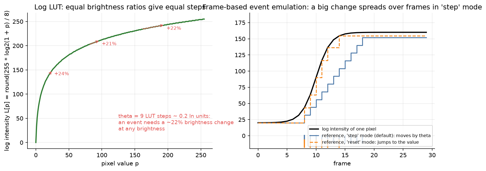

`theta = 9` LUT steps is about 0.2 ln units: an event needs roughly a 22% brightness change, at any brightness. The effect of the threshold on one clip:

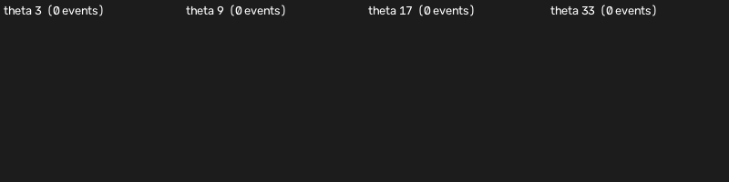

And the on-chip pattern source (a moving square on a gradient) through the same emulator, which is what the first VGA demo shows on a monitor:

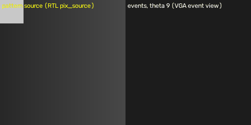

**Implementation:** a two-stage pipeline (RAM read and compare, then update and emit) at one pixel per clock, 252 ALMs and 21 RAM blocks, Fmax 158 MHz (the first one-stage version had -1.5 ns slack at 125 MHz, bug 1). The output goes through a 1024-entry FIFO; if it fills, the pixel source is stalled (back-pressure), so **no event is ever dropped**. It is bit-exact to `model/emulator_int.py` on 7 scenarios, including full-frame bursts, a stalled consumer, theta 1 and 255, and timestamp wrap. An independent float implementation (`model/emulator_ref.py`) and a comparison script against the v2e simulator (`scripts/compare_vs_v2e.py`, self-tested on a fake v2e file only; **not yet run on real v2e output**) exist for realism checks.

---

## The spiking neural network

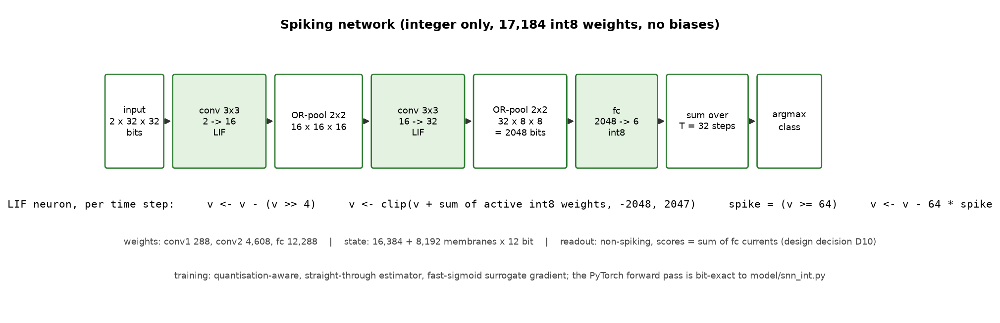

| Layer | Operation | Output |
|---|---|---|
| input | OFF/ON presence bins | 2 x 32 x 32 bits |
| conv1 | 3x3, zero padding, 2 -> 16, LIF | 16 x 32 x 32 |
| pool1 | 2x2 OR of spikes | 16 x 16 x 16 |
| conv2 | 3x3, 16 -> 32, LIF | 32 x 16 x 16 |
| pool2 | 2x2 OR | 32 x 8 x 8 = 2048 bits |
| fc | 2048 -> 6, int8, no bias | 6 class currents per step |
| readout | **sum** of class currents over a window of T = 32 steps, argmax (ties to the lowest class) | class |

**Neuron (integer only):** `v <- v - (v >> 4)` (leak), `v <- clip(v + I, -2048, 2047)` where `I` is the sum of the int8 weights of the active input bits (a conditional add: no multiplier anywhere), `spike = v >= 64`, `v <- v - 64 * spike` (reset by subtraction).

**Training:** quantisation-aware (straight-through estimator, fast-sigmoid surrogate gradient scaled by 1/threshold, calibrated initial weights so that layers fire 8-10% at the start). The PyTorch forward pass is **bit-exact** to the integer model (`model/snn_int.py`) that the RTL is verified against, so there is no train/deploy gap. Why a non-spiking readout: spiking output neurons sat at chance accuracy (they fire always or never); summing class currents learned immediately (bug 11, decision D10).

---

## Training data and results

**Demo network: [KTH actions](https://www.csc.kth.se/cvap/actions/)** (599 videos, 25 people, 4 conditions, 160x120, 25 fps; 2,390 repetitions). Frames are squashed to 128x128, resampled 25 to 30 fps, passed through the integer emulator (theta 0.2 ln, step mode) and binned. Person split of the original paper: train 11-18 (760 repetitions), validation 8 people (768), test 9 people (862). Settings were chosen on validation people only; the test people were scored once.

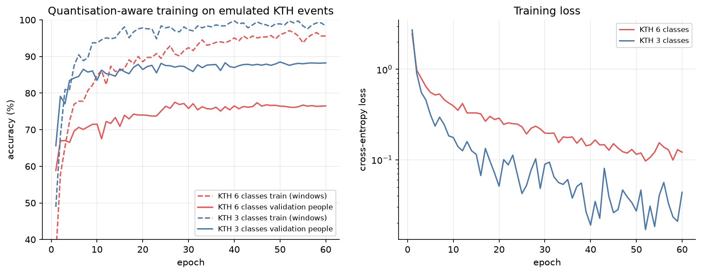

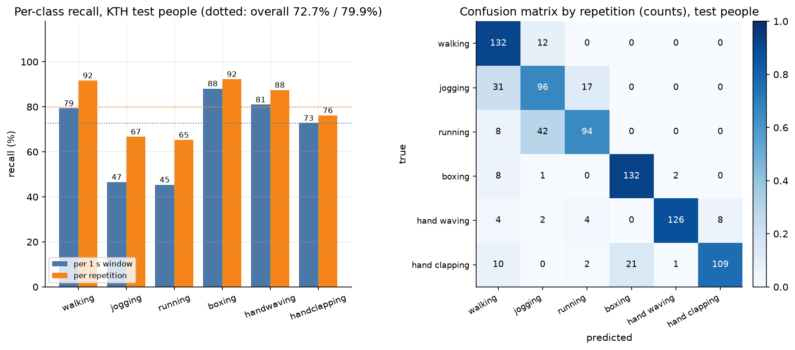

| | window accuracy | sample (clip) accuracy |
|---|---|---|
| validation people | 76.5% | 80.7% |
| **test people** | **72.7%** | **79.9%** |
| test, per condition (window) | d1 81%, d2 (scale change) 58%, d3 (clothes) 77%, d4 (lighting) 79% | |

Jogging and running are confused with each other and with walking (they differ mainly in speed, which 32x32 presence maps over one second carry little of). Details and the exact confusion matrix: [`docs/results/kth6_accuracy.md`](docs/results/kth6_accuracy.md).

### Running scores on real clips
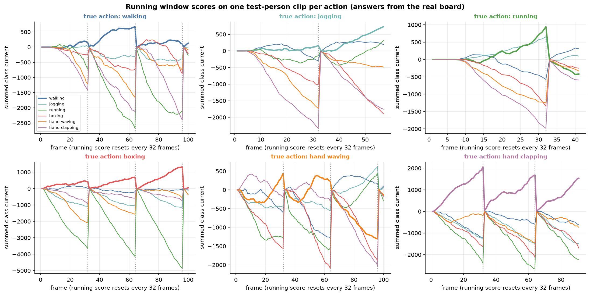

Each panel is one test-person clip streamed to the board (true action in the title; the plotted scores are the board's). The thick line is the true class; the scores reset every 32 frames when the window answer is read out. The model is not always right inside a window (see the walking and hand-waving panels), which is why the clip-level answer sums several windows.

### Sparsity: what makes this cheap
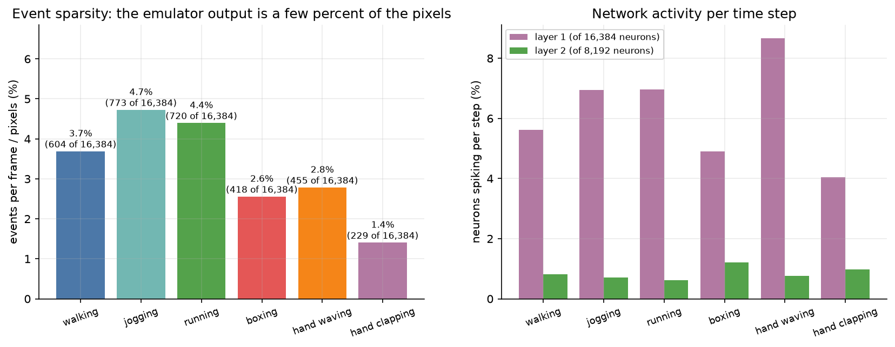

### Real DVS reference (Track A)
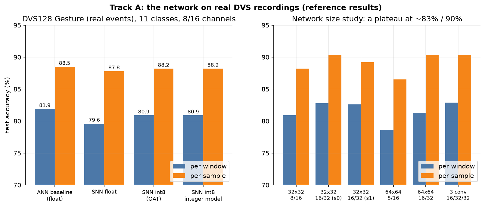

The same architecture on **real** DVS128 Gesture recordings (IBM, 11 classes, 29 subjects) reaches 82.7% per window / 89.8% per sample with int8 weights at 16/32 channels. In the first 8/16-channel comparison (left) a float ANN on time-averaged frames got 81.9% / 88.5%, a float SNN 79.6% / 87.8% and the int8 network 80.9% / 88.2%, so int8 quantisation costs nothing measurable here. Size study, regularisation study and third conv layer: all land within noise of an ~83% / 90% plateau ([`docs/results/trackA_accuracy.md`](docs/results/trackA_accuracy.md)).

---

## Comparisons and ablations

### The domain gap
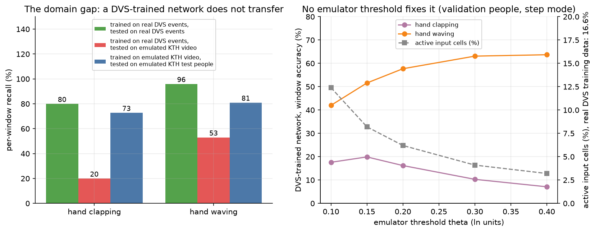

A network trained on **real** DVS events was run on events **emulated** from KTH hand-clapping and hand-waving video: clapping fell from 80% to 20-25%, waving from 96% to 52%, and no emulator threshold or update mode fixes it (validation sweep, right). The real-event training data has 16.6% of its input cells active per step, the emulated KTH events 3-6%, and the actions themselves differ, so the cause is a mix of sparsity, scale and motion style, not a bug in the emulator (the RTL is bit-exact to its model). Consequence: **the demo network is trained on emulated events** ([`docs/results/kth_domain_gap.md`](docs/results/kth_domain_gap.md)).

### 3 classes versus 6
| Classes | Validation (window / sample) |
|---|---|
| clapping, waving, boxing | 88.2% / 90.4% |
| all six KTH actions | 76.5% / 80.7% |

The drop is almost entirely jogging versus running.

### Variants tried on the 6-class task (validation people, one seed each)
| Variant | window | sample |
|---|---|---|
| **baseline (frozen)** | **76.5%** | **80.7%** |
| event dropout 0.1 | 76.5% | 80.0% |
| window T = 48 steps | 77.0% | 81.1% |
| weight decay 0.01 + dropout 0.05 | 75.9% | 80.7% |

Differences below ~1.5 points are noise at this sample size, so the simplest network (T = 32) is kept.

### Float versus integer, ANN versus SNN (Track A)
Int8 QAT 80.9% vs float SNN 79.6% vs float ANN baseline 81.9% (8/16 channels). The integer model reproduces the QAT numbers on all 1,377 test windows.

---

## Hardware implementation

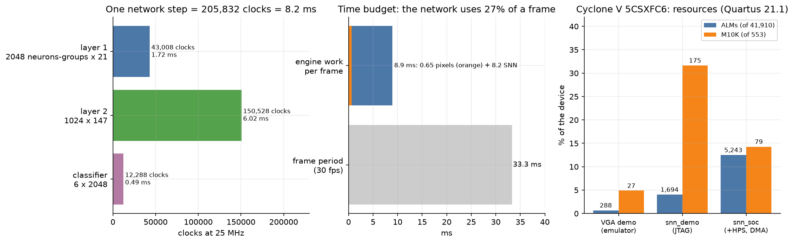

- **`lif_conv`** computes one 3x3 layer *output-stationary*, 8 output channels at a time: for each neuron position the CIN x 9 input bits are fetched one per clock and conditionally added into 8 accumulators; then leak, saturation, threshold and reset are applied and written back; spikes are OR-ed into the pooled word. Per step: layer 1 = 2,048 position-groups x 21 clocks, layer 2 = 1,024 x 147, classifier 12,288 = **205,832 clocks**. No multipliers, no DSP blocks, one 25 MHz clock domain.
- **`bin_builder`** double-buffers the 2x32x32 presence map (two 2048-bit banks); `frame_sync` closes a frame only when the emulator and its FIFO are idle; clearing a bank uses back-pressure, never drops.
- **`snn_engine`** (the part behind the ARM) adds a 64-bit DMA reader with a byte FIFO, a scheduler, and a CSR block whose result registers are snapshots taken when `DONE_SEQ` increments.
- **Memory**: weights in ROMs initialised from hex files (checked word-for-word against what Quartus extracted: `scripts/check_mif.py`), membranes 16,384 + 8,192 x 12 bit in M10K.

| Build | ALMs | RAM blocks | DSP | Worst setup slack | Notes |
|---|---|---|---|---|---|
| emulator only (`emu_probe`) | 252 | 21 | 0 | +1.68 ns at 125 MHz | Fmax 158 MHz |
| VGA demo (`demo`) | 288 | 27 | 2 | +31.6 ns (25 MHz) | pattern -> emulator -> event view on a monitor |
| SNN demo (`snn_demo`) | 1,694 | 175 | 2 | +15.0 ns (25 MHz) | incl. 786 kbit demo-clip ROM; JTAG, no HPS |
| **SNN SoC (`snn_soc`)** | **5,243** | **79** | **0** | +10.8 ns (25 MHz), +1.73 ns (HPS DDR3 domain) | HPS + DDR3 + DMA + engine; clips from the laptop |

Device: 5CSXFC6D6F31C6 (41,910 ALMs, 553 RAM blocks, 112 DSP). Reports: [`docs/results/snn_rtl.md`](docs/results/snn_rtl.md), [`docs/results/snn_soc.md`](docs/results/snn_soc.md), [`docs/results/emulator_synth.md`](docs/results/emulator_synth.md). Architecture write-up: [`docs/snn_arch.md`](docs/snn_arch.md).

---

## Verification

The method: every hardware block has a **bit-accurate Python golden model**, vectors are generated from it, and a self-checking Verilog bench must reproduce them exactly; a bench passes only on an explicit `RESULT: PASS` line and no `MISMATCH` (the simulator's exit code is never the signal).

| What | Bench | Compared against | Result |
|---|---|---|---|
| event emulator | 7 scenarios (full frames, gaps, stalled consumer, bursts, theta 1/255, timestamp wrap) | `model/emulator_int.py` | bit-exact |
| VGA event view | 11 complete 640x480 frames | pattern -> emulator -> view model | pixel-exact |
| SNN core, builder, controller | random net, saturating net (both membrane rails, int8 extremes, an exact score tie), real KTH net | `model/snn_int.py`: per-step spike counts, 6 class currents, **both membrane RAMs**, window class and scores | 0 mismatches |
| emulator -> bins -> SNN chain | pattern source, a full 32-frame window with the real network | Python chain model | 0 mismatches |
| engine behind the HPS | real KTH boxing frames through a DDR3 model with random wait states, 3 frames queued | Python chain model, DMA word count | 0 mismatches |
| board top level | keys, switches, 7-segment and LED outputs in replay and live mode | model class | equal |
| QAT forward pass | `train/tests/test_qat_vs_int.py` | integer model | identical |

**Does the test suite see faults?** `scripts/run_regression.py --selftest` and `scripts/snn_regression.py --selftest` re-run the benches against deliberately broken copies of the RTL (wrong comparison, swapped coordinates, logical instead of arithmetic shift, pooling AND instead of OR, off-by-one saturation at either rail, wrong right-edge padding, no reset by subtraction, unsigned weights, wrong argmax tie rule, wrong ring slot, wrong CSR snapshot, ...). **every harmful variant on the emulator side (12 of 12) and 14 of 15 on the SNN side are caught**; one emulator-side variant is deliberately harmless (slower but correct) and must not be flagged, and the one SNN-side survivor is a margin the simulation cannot distinguish (documented). The first run exposed that the bench could not see a clipping error or a tie, so membrane-RAM checks and a tie case were added (bug 28): the self-test found a hole in the test, not only in the design.

```
.venv\Scripts\python.exe scripts\run_regression.py            # all benches + pytest
.venv\Scripts\python.exe scripts\run_regression.py --selftest # broken RTL must fail
```

---

## Measured on the board

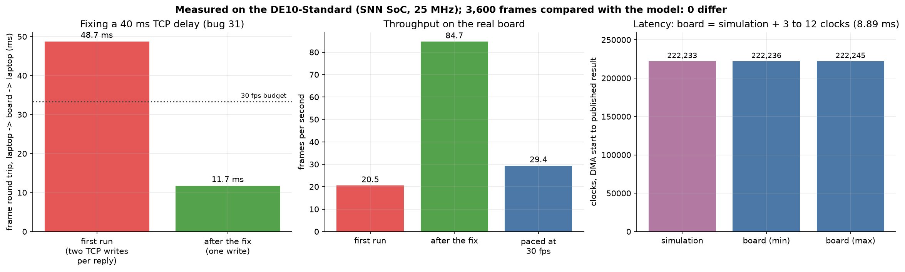

| Check | Result |
|---|---|
| FPGA image loaded from the SD card by U-Boot | `devmem 0xFF210000` = `0x534E0001` (our build id), STATUS ready, CLOCK_HZ 25,000,000 |
| Daemon on the ARM (compiled on the board with its gcc) | starts, releases the FPGA-to-SDRAM port reset, listens on port 5002 |
| **Board vs bit-accurate models, frame by frame** (`scripts/check_board.py`) | 12 clips (all six actions, 7 people, conditions d1-d4) x 300 frames = **3,600 frames, 0 differ** in spike counts, event counts, class currents, running scores, window counters and window answers; repeated after every daemon change |
| Latency, DMA start to published result | 222,236 to 222,245 clocks = **8.89 ms** on the board (222,233 in simulation); network step 205,831 clocks = 8.23 ms |
| Throughput | 29.4 frames/s sustained at the real-time pace; 84.7 frames/s flat out over an 8,000-frame soak |
| Soak (8,000 frames) | `DONE_SEQ` = `IN_RD_SEQ` = 8000, 250 windows, no overrun, no emulator error flag |
| Whole-video clip answers, person 22 | walking, jogging, boxing, hand waving, hand clapping correct; **running called jogging** (the known weak pair) |

**One bug only the board could show** (bug 31): the first run delivered 20 frames/s because every reply left the ARM as two small TCP writes and each message paid a 40 ms delay (a single 4-byte register read took 39 ms). Sending each reply in one write brought a frame round trip from 48.7 ms to 11.7 ms and a register read to 1.6 ms. The simulation could not have shown it.

Full table and logs: [`docs/results/board_run.md`](docs/results/board_run.md).

---

### ARM-only baseline: the ARM is faster

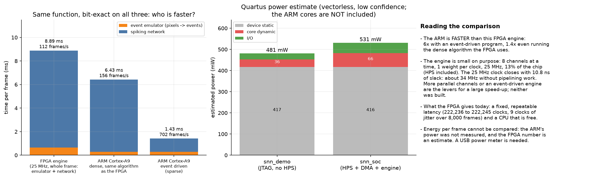

The same pipeline in C on the board's own Cortex-A9 (`sw/arm_baseline.c`, compiled on the board, **bit-exact to the model on every frame in both implementations**): the dense version, which is the algorithm the FPGA runs, takes 6.43 ms per frame (156 frames/s); an event-driven version takes **1.43 ms (702 frames/s)**; the FPGA engine takes 8.89 ms (112 frames/s). So for this small network **the CPU beats this FPGA engine**: it processes 8 channels at a time at 25 MHz and uses about 13% of the chip. What the FPGA path offers is a fixed latency (222,236-222,245 clocks over 8,000 frames) and a free CPU. Parallel channels or an event-driven engine would be the route to speed; neither is built. Details and caveats: [`docs/results/arm_baseline.md`](docs/results/arm_baseline.md).

### Power: an estimate only
Quartus's vectorless estimate for the FPGA fabric is 481 mW (JTAG demo) and 531 mW (SoC design), of which 416 mW is device static power; the design's own dynamic power is 36 mW and 66 mW. The tool rates its own confidence "low", the ARM cores are not included, so **no FPGA-versus-ARM energy statement is possible** until it is measured with a USB power meter ([`docs/results/power.md`](docs/results/power.md) says how).

### Footage that is not from KTH
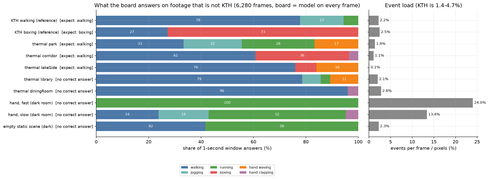

Ten clips, 6,280 frames of thermal pedestrian sequences (CDnet) and a hand moving in a dark noisy room went through the real board: **board and model agree on all 6,280 frames**, but the answers show the limits of the network. On walking footage that is not KTH the clip answer is right every time, yet only 33-76% of the 1-second windows say walking (78% on KTH). There is **no "none of the above"**: a person sitting down is called walking in 79% of windows, and an empty dark scene, where only sensor noise produces events, is called running or walking in every window; dense noisy input (13-24% of pixels as events, against 1-5% on KTH) gives "running". Details, per-clip table and how to try your own phone clips: [`docs/results/ood_test.md`](docs/results/ood_test.md).

---

## The main clips and what the board answered

### KTH test person 22, one clip per action, whole videos

The six clips of the GIF below the table, played in full through the real board at 30 frames/s. The answer of each finished 32-frame window (about one second) and the clip answer (largest sum of the window scores) are the board's own; every clip ran with 0 board errors.

| Clip (board GIF) | Frames | Windows | Windows naming the true action | Most frequent window answers | Clip answer |
|---|---|---|---|---|---|
| [walking](docs/media/demo_walking_board.gif) | 839 | 26 | 77% | walking 20, jogging 4, running 2 | **walking** |
| [jogging](docs/media/demo_jogging_board.gif) | 595 | 18 | 33% | walking 9, jogging 6, running 3 | **jogging** |
| [running](docs/media/demo_running_board.gif) | 449 | 14 | 29% | walking 7, running 4, jogging 2 | jogging (wrong) |
| [boxing](docs/media/demo_boxing_board.gif) | 362 | 11 | 73% | boxing 8, walking 3 | **boxing** |
| [hand waving](docs/media/demo_handwaving_board.gif) | 899 | 28 | 61% | hand waving 17, hand clapping 5, running 4 | **hand waving** |
| [hand clapping](docs/media/demo_handclapping_board.gif) | 412 | 12 | 100% | hand clapping 12 | **hand clapping** |

Five of six clips are answered correctly. The window answers show where the network struggles: jogging and running are mostly called walking inside a window, and only the sum over the whole clip gets jogging right; running stays wrong. In boxing, the last windows say walking because the person walks out of the picture at the end.

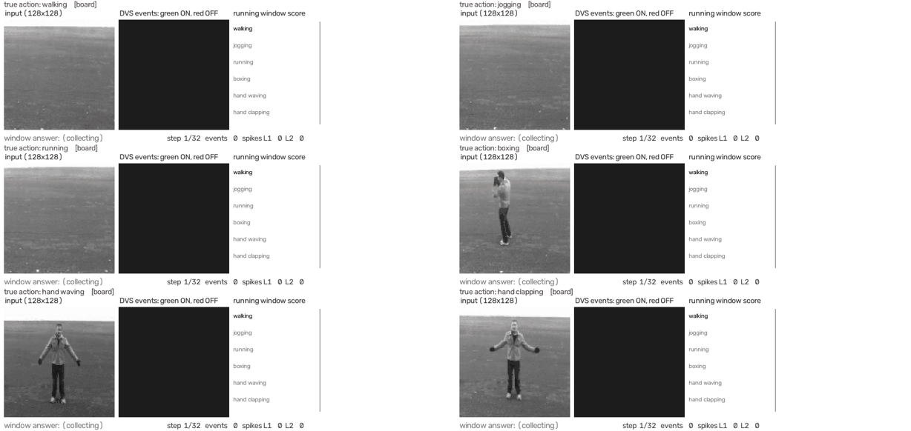

*Input frame, the DVS events the emulator makes from it (drawn on the laptop from the same bit-exact model, because the board returns counts, not images), and the running scores of the six classes, **which are the real board's answers** (tag `[board]`). Versions with the Python model's answers (`demo_*_sim.gif`) are in `docs/media/`; they are identical frame by frame.*

### Phone clips (not KTH)

Four clips filmed with a phone: one person, 8-10 m away at the end of a long corridor, strongly backlit (mostly a silhouette), handheld, 15 s each. Every frame went through the board and the model: **board == model on all 3,640 frames**.

| Clip | True action | Original (whole picture): clip answer, windows | Mild crop + shake removal: clip answer, windows |
|---|---|---|---|
| hand_waving1 | hand waving | **hand waving**, 12 of 14 | **hand waving**, 14 of 14 |
| hand_waving2 | hand waving | **hand waving**, 11 of 14 | **hand waving**, 14 of 14 |
| hand_clapping1 | hand clapping | hand waving, 14 of 14 | hand waving, 12 of 14 |
| hand_clapping2 | hand clapping | hand waving, 11 of 14 | hand waving, 10 of 14 |

- **Hand waving works** (every window on the cropped clips; this is the clip in the GIF at the top of this page). **Hand clapping is never recognised**: not one of 56 windows says clapping. From that far away the hands are a few pixels at 128x128 and clapping and waving look alike.
- **Preparing the clips: zoom hurts.** A tight crop (2.7x) made the board's answers worse: 0 of 4 right, hand waving answered running and jogging. The phones drift 15-25 px and jitter 0.4-0.6 px per frame, and a tight crop turns that into events on every wall edge. A sweep on the model (5 crop widths x shake removal on / off, 4 clips, so indicative only) found shake removal cuts the event rate 2.5-3.5x, and a mild crop (640 px wide, 1.3x) with shake removal was the best variant, though not clearly better than the uncropped clip.

| Crop width (854 = no crop) | Shake removal | Events (% of pixels) | Windows naming the true action |
|---|---|---|---|
| 854 | off | 1.3% | 42% |
| 640 | on | 0.6% | **45%** |
| 420 | on | 1.1% | 18% |
| 320 | off | 4.1% | 18% |
| 320 | on | 1.6% | 25% |

Tools: `scripts/crop_user_clips.py --stabilize` (crop + shake removal), `scripts/crop_sweep.py`, `scripts/user_clip_test.py --connect <board>`. Full record: [`docs/results/user_clips.md`](docs/results/user_clips.md).

### Thermal and night-time footage

Covered above in [Footage that is not from KTH](#footage-that-is-not-from-kth): 10 clips, 6,280 frames, board == model on every frame; walking is still found in thermal video, while noise and actions outside the six give confident wrong answers.

---

## Hardware status

| Item | Status |
|---|---|
| Emulator RTL, SNN RTL, engine RTL | bit-exact in simulation |
| Quartus builds (`demo`, `snn_demo`, `snn_soc`) | done, timing met at all corners |
| `snn_soc` on the board (HPS + DMA + engine, clips over Ethernet) | **running**: bit-exact against the models on 3,600 frames, 8,000-frame soak without errors, real-time at 29.4 frames/s |
| `snn_demo` on the board (JTAG, replay of six clips, live pattern) | programmed earlier; the author reported it works (one-line report: no per-clip results or photos recorded) |
| ARM daemon `snn_streamer.c` | running on the board, compiled there |
| HEX/LED display | **filmed** in the phone video at the top: the 7-segment digits agree with the page (frame count, step in the window, class 4 = hand waving). `python scripts/photo_session.py --host 192.168.137.200` plays each action and says which digit HEX0 must show |
| Browser live demo (`snn_web.py`) | **running with the board**: board == model counted live on every frame (462 / 462 on the filmed phone clip); webcam path tested with the model and with JPEG-encoded KTH frames, not yet with a real webcam on the board |
| Phone clips | **done** on the board: 3,640 frames, board = model on every frame; waving recognised, clapping not (`docs/results/user_clips.md`) |
| Recorder for training clips | works in a browser test (headless Edge, Chromium's fake camera): save, list, play, delete, recording while the classifier runs; not yet tried with a real webcam |
| ARM-only software baseline | **done**: bit-exact on the board, 6.43 ms dense / 1.43 ms event-driven per frame against 8.89 ms for the FPGA engine (`docs/results/arm_baseline.md`) |
| Power | Quartus estimate only (`docs/results/power.md`); not measured on the board |
| Non-KTH footage | **done** on the board: 6,280 frames, board = model on every frame; the network's answers degrade as expected (`docs/results/ood_test.md`) |
| v2e comparison on real v2e output | not done |

Step-by-step bring-up with the exact expected displays and a bit-exact board-versus-model check: [`docs/snn_soc.md`](docs/snn_soc.md) (clips over Ethernet) and [`docs/snn_bringup.md`](docs/snn_bringup.md) (JTAG demo).

---

## Sending video clips from the laptop

```
python scripts/snn_viewer.py --source clip.avi --connect 192.168.137.200       # real board
python scripts/snn_viewer.py --source clip.avi --sim                           # no hardware: the Python models answer
python scripts/snn_viewer.py --source a.avi b.mp4 webcam:0 --connect <ip> --loop --save out.mp4
python scripts/check_board.py --host <ip> --source clip.avi --frames 200       # board must equal the models, frame by frame
```

On the real board this runs at the real-time pace (29.4 frames/s). The frontend prepares each frame exactly like the training data (grey, whole frame squashed to 128x128 with area averaging, 30 fps with the same blending arithmetic as `train/kth.py`; both are unit-tested against the training code), sends it over TCP, and shows the frame, the DVS events, the running scores and the answer of the last finished window; for a clip it prints the clip class (largest sum of window scores). Protocol, CSR map and board setup: [`docs/snn_soc.md`](docs/snn_soc.md).

---

## Live demo in the browser

The GIF at the top of this page is the live demo filmed on the real setup (laptop + board). Below, a screen capture of the page itself:

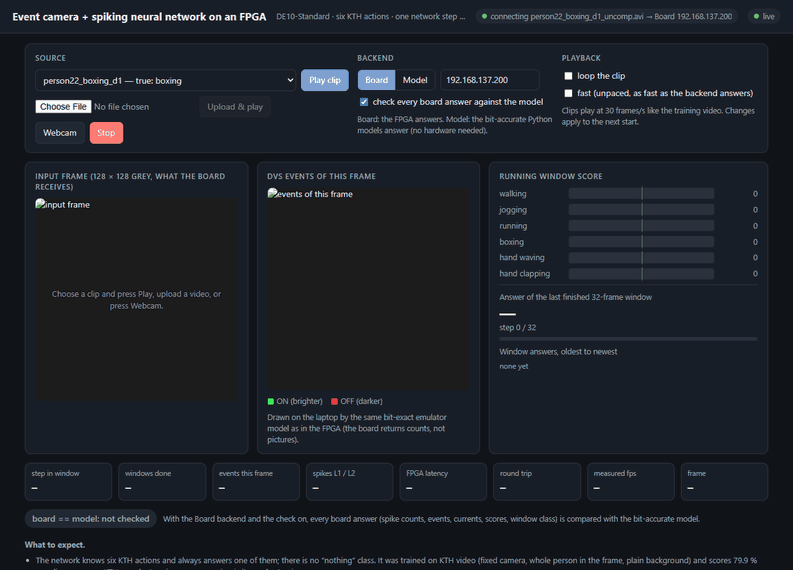

*The page while the real board classifies a KTH boxing clip at 30 frames/s. Every board answer is checked live against the bit-accurate model (362 / 362 frames identical). The last windows say "walking" because the person walks out of the picture; the clip answer is still boxing. Still image: [`docs/media/live_demo.png`](docs/media/live_demo.png).*

```
.venv\Scripts\python.exe scripts\snn_web.py --board 192.168.137.200     # the FPGA answers; opens http://127.0.0.1:8080
.venv\Scripts\python.exe scripts\snn_web.py                             # no hardware: the bit-accurate Python models answer
```

One self-contained page (`sw/web/index.html`, nothing loaded from the internet) served by a standard-library Python server:

- **Sample clip + Play clip**: KTH clips of two test people, all six actions, with the true action shown.
- **Upload & play**: any video file OpenCV can decode (up to 200 MB by default, `--max-upload-mb`).
- **Webcam**: browser camera, centre-cropped to 4:3, sent as about 320x240 JPEG at up to 30 frames/s.
- **Board / Model**: the FPGA at the given host, or the Python models.
- **Check every board answer against the model**: shows "board == model: N / N frames match", comparing every field of every RESULT.
- **Loop**, **Fast** (unpaced, about 70 frames/s with the board) and **Stop**.

The page shows the input frame, the DVS events of that frame (green ON, red OFF), the six running window scores with the leader highlighted, the answer of the last finished 32-frame window, the history of window answers, counters (step n/32, events, spikes L1/L2, FPGA latency 8.89 ms, round trip about 14 ms, measured frames/s), and the clip answer with a correct/wrong mark at the end of a clip.

The board connection is held only while a source runs, so `check_board.py` works between runs (tested). A forgotten tab cannot hold the board: a silent webcam is stopped after 6 s, any source with no page open after 15 s. A missing or busy board shows an error and offers the Model backend.

Webcam frames are noisier than a video file. In a test that sent KTH clips the way the page sends webcam pictures (320x240 JPEG), the clip answers matched the file's on 12 / 12 clips and the window answers on 86 %. Stand back so your whole body is in the picture, in front of a plain wall: the network knows only the six KTH actions. A real webcam has not been tested yet. Details, API and test record: [`docs/live_demo.md`](docs/live_demo.md).

---

## Recording your own training clips

The live demo page has a **Record training clips** panel, so new training data can be collected with the laptop's webcam (no board needed, and the classifier can keep running at the same time):

1. Choose the **action** (the six KTH actions, or *none* for "no action", the data a future reject class would need), type a **subject** name (it keeps one person's clips together when the data is split into training and test, as KTH is split by person), pick a **length** (5-30 s, or until stopped, at most 60 s) and optionally a note.
2. Press **Record**: a 3 s countdown, then every frame the camera delivers is grabbed (`requestVideoFrameCallback`), centre-cropped to 4:3 like KTH, up to 640x480, and the preview shows exactly what is saved.
3. The clip is saved as `data/recordings/<action>/<subject>_<action>_<YYYYmmdd-HHMMSS>.avi` (MJPG at the frame rate the camera really delivered) plus a `.json` with the label, the subject, the camera and **the capture time of every frame**. The page warns when the camera delivered fewer than 25 frames/s (low light), when frames are missing, or when the tab was hidden.
4. The list under the panel shows every recording with its length and frame rate, counts per action (to keep the classes balanced), **Play** (classify it with the current backend) and **Delete** (moved to `data/recordings/_trash/`, not erased).

For training, `train/recordings.py` turns each recording into exactly the input the KTH network was trained on: grey, squashed to 128x128 and blended to 30 fps using the real capture times, so a camera that runs at 29.7 or 20 frames/s still gives correct timing:

```python
from train.recordings import load_recordings, REC_ACTIONS
for frames, meta in load_recordings("data/recordings"):            # frames: uint8 [n, 128, 128] at 30 fps
    print(meta["file"], meta["label"], meta["subject"], frames.shape)
# actions=REC_ACTIONS adds "none" as class 6; subjects={...} selects people (for a train / test split)
```

Tested: 13 unit tests (save, the training loader, rejected inputs, trash; `sw/tests/test_web_record.py`) and a browser test that drives the real page in headless Edge with Chromium's fake camera (`scripts/web_record_check.mjs`: fixed length with countdown, until stopped, cancel, recording while the classifier runs, play, delete). Not yet done: recording with a real webcam, and training on recordings (`train.prep_kth` does not read them yet).

---

## Reproduce everything

```
python -m venv .venv --system-site-packages        # Python 3.14 here; torch 2.14+cu126, cocotb already present
.venv\Scripts\python.exe -m pip install opencv-python tonic

# data (not in the repo; see docs/datasets.md): KTH zips -> data/kth/videos, DVS128 Gesture -> DVSGesture/
.venv\Scripts\python.exe -m train.prep_kth                                        # -> data/kth32/{train,val,test}.npz
.venv\Scripts\python.exe -m train.train_snn --dataset kth --data data/kth32 --T 32 --epochs 60 --lr 0.008 --out train/runs/kth6_32_16_32
.venv\Scripts\python.exe -m train.eval_kth6 --weights train/runs/kth6_32_16_32 --data data/kth32 --split val --int-check 40
.venv\Scripts\python.exe scripts\export_kth6.py --run train/runs/kth6_32_16_32    # ROM images + demo clips -> rtl/weights/kth6

# checks
.venv\Scripts\python.exe scripts\run_regression.py [--selftest] [--snn-top]
bash scripts/build_quartus.sh quartus/snn_demo snn_demo divclk                    # JTAG demo bitstream
bash scripts/build_snn_soc.sh --generate                                          # SoC with HPS (needs the night-vision project beside this one)

# every figure and GIF in this README
.venv\Scripts\python.exe scripts\make_readme_media.py
.venv\Scripts\python.exe scripts\make_demo_gif.py --src data/user_clips/demo_video.mp4

# on the board (daemon running): bit-exactness, footage that is not KTH, phone clips, live demo
.venv\Scripts\python.exe scripts\check_board.py --host 192.168.137.200 --source <clip> --frames 300
.venv\Scripts\python.exe scripts\ood_test.py --connect 192.168.137.200
.venv\Scripts\python.exe scripts\user_clip_test.py --connect 192.168.137.200
.venv\Scripts\python.exe scripts\snn_web.py --board 192.168.137.200
```

Toolchain: Quartus Prime Lite 21.1, Icarus Verilog 14, Questa FSE, Windows 11, an RTX 3050 Ti for training. No dataset is needed to try the pipeline: `python sw/frame_feeder.py --synthetic blob --preview work/prev` and `python -m train.train_snn --dataset toy` run on synthetic data.

---

## Repository layout

| Path | What |
|---|---|
| `rtl/` | Verilog: `event_emulator`, `event_fifo`, `log_lut`; SNN: `snn_core`, `lif_conv`, `bin_builder`, `snn_ctrl`, `frame_sync`; engine: `snn_engine`, `dma_rd`, `fifo_64to8`; demos: `demo_top`, `snn_demo_top`, `clip_replay`, `pix_source`, `event_view`; `weights/kth6/` (ROM images, demo clips) |
| `tb/` | self-checking Icarus benches |
| `model/` | bit-accurate golden models (`emulator_int`, `snn_int`), float emulator, binning, event format, LUT, toy data; `tests/` |
| `train/` | QAT SNN, training and evaluation for KTH and DVS128, AEDAT parser, `recordings.py` (recorded webcam clips as training data), equivalence tests |
| `sw/` | `snn_streamer.c` (ARM daemon), `arm_baseline.c` (the pipeline in C for the ARM), `host/` (protocol, simulated board), `web/` (live-demo page), `tests/` |
| `scripts/` | regression, vector and ROM generators, `snn_viewer.py`, `snn_web.py` (browser live demo + recorder), `check_board.py`, `ood_test.py`, `user_clip_test.py`, `crop_user_clips.py`, `crop_sweep.py`, `photo_session.py`, `web_record_check.mjs` (browser test), Quartus build scripts, `make_readme_media.py`, `make_demo_gif.py` |
| `quartus/` | `emu_probe`, `demo`, `snn_demo` (JTAG), `snn_soc` (HPS + DMA) |
| `releases/` | archived bitstreams with the SHA-256 of their sources |
| `docs/` | `snn_arch.md`, `snn_soc.md`, `snn_bringup.md`, `architecture_decisions.md`, `bug_log.md`, `datasets.md`, `board_notes.md`, `results/`, `media/` |
| `roadmap_1_event_camera_snn.md` | the plan, ticked as it was done, with the status at the top |

---

## Limitations

- The network knows **six actions and always answers with one of them**; there is no "none of these" class.
- It was trained on KTH (a static camera, a whole person in a 160x120 frame, plain backgrounds). On unseen KTH people it scores 79.9% per clip; clips unlike that (moving camera, person filling the frame, busy background) are outside what was measured and will do worse.
- **Jogging versus running** is the weak pair (~66% per clip); the 25 fps source and 32x32 presence maps carry little speed information.
- The results are from **one seed** per configuration; differences under about 1.5 points are noise.
- **The ARM beats this FPGA engine on speed** (1.43 ms event-driven, 6.43 ms dense, against 8.89 ms); the engine is small and was built for exactness and a fixed latency, not throughput.
- **No reject class**: footage that shows none of the six actions, or only sensor noise, is still answered with an action (see the non-KTH test).
- **Footage unlike KTH** degrades: a person far away or backlit, hand clapping from a distance (never recognised in the phone clips), a handheld camera. The phone-clip results are from one person and two actions.
- Not done: a measured power comparison (needs a USB power meter), an event-driven or more parallel FPGA engine, v2e comparison on real v2e output, an on-board VGA overlay of the class, training on clips recorded with the recorder.
- The DVS-trained network does not transfer to emulated video; the emulator is bit-exact to its own model, but its resemblance to a real sensor's events is not established beyond sparsity statistics.

---

## Adding board results

The GIFs and plots above were generated with the board's real answers (files with the suffix `_board`); regenerate them after any change with:

```
.venv\Scripts\python.exe scripts\make_readme_media.py --only gifs --connect 192.168.137.200
```

The phone video at the top is made into a GIF and a still with `python scripts/make_demo_gif.py --src data/user_clips/demo_video.mp4` (600 px, 6 frames/s, one shared palette; the video itself is not in the repository). Still to add: a power measurement.

---

## Datasets, licences, references

- **KTH actions**: Schuldt, Laptev, Caputo, "Recognizing human actions: a local SVM approach", ICPR 2004. Public for non-commercial use. https://www.csc.kth.se/cvap/actions/
- **DVS128 Gesture**: Amir et al., "A Low Power, Fully Event-Based Gesture Recognition System", CVPR 2017. CC BY 4.0, IBM Research.
- **v2e** (event simulator used as a reference, comparison script only): Hu, Liu, Delbruck, "v2e: From Video Frames to Realistic DVS Events", CVPR Workshops 2021.
- The ARM daemon, DMA reader, byte FIFO and the HPS/DDR3 system come from the author's earlier night-vision project on the same board.
- The raw datasets are not in this repository (`data/` and `DVSGesture/` are git-ignored); see [`docs/datasets.md`](docs/datasets.md). The DE10-Standard user manual is Terasic's and is not included; get it from terasic.com.
- **Licence**: MIT ([`LICENSE`](LICENSE)) for the code and documentation of this project. The datasets keep their own licences (above).
